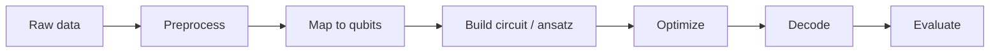

<div align="center">

# ❓ Problem Statements, Solutions & Terms

**What you are building, how you will be judged, and the rules of the game.**

</div>

---

> **📣 Organiser note — content below marked `<!-- ORGANIZER -->` is a
> placeholder.** Replace it with the official problem statements and terms
> before circulating this guide to teams.

---

## 📌 Table of Contents

- [1. How to use this guide](#1-how-to-use-this-guide)
- [2. The tiers: Online, Offline, Both](#2-the-tiers-online-offline-both)
- [3. How to read a problem statement](#3-how-to-read-a-problem-statement)
- [4. The official problem statements](#4-the-official-problem-statements)
- [5. Solution design: from statement to submission](#5-solution-design-from-statement-to-submission)
- [6. Common quantum problem archetypes](#6-common-quantum-problem-archetypes)
- [7. Evaluation rubric](#7-evaluation-rubric)
- [8. What you are expected to build](#8-what-you-are-expected-to-build)
- [9. Terms and conditions](#9-terms-and-conditions)
- [10. FAQ](#10-faq)

---

## 1. How to use this guide

This guide has three jobs:

1. **Explain the official problem statements** — what your team is solving.
2. **Show how to design a solution** — how to move from a statement to a
   working quantum program.
3. **Set out the terms and conditions** — the rules everyone plays by.

Read sections 2–4 first. Then use section 5 to plan your build, and section 7
to understand how you will be scored.

---

## 2. The tiers: Online, Offline, Both

Every registered team is assigned a **tier**, shown in your repository
description and in the team registry.

| Tier | What it means | What you need |
| :--- | :--- | :--- |
| **Online** | You participate remotely. | A laptop, the internet, and a GitHub account. Everything happens through GitHub and Zoom/Meet. |
| **Offline** | You participate on campus. | A workspace, a projector for demos, and a demo slot on the day. |
| **Both** | Hybrid — you may work remotely but demo in person. | Be ready to demo live, online or on stage. |

### Why the tier matters for your build

- **Online** teams should make their work *reproducible remotely*: a clean
  `README`, pinned dependencies, and a demo that can be recorded.
- **Offline** teams can rely on a projector and live demo — but still commit a
  recorded backup in case the live demo fails.
- **Both** teams: assume you will present live. Prepare a 3-minute demo script
  **and** a recorded video.

---

## 3. How to read a problem statement

Every problem statement is written with the same skeleton. Read it in this order:

```text
1. CONTEXT       Why does this problem matter? (the story)
2. TASK          What exactly must you do? (the deliverable)
3. INPUTS        What data / parameters are you given?
4. CONSTRAINTS   Limits on qubits, depth, runtime, hardware.
5. OUTPUTS       What does a correct solution produce?
6. METRICS       How is your solution scored?
```

### Worked example of the skeleton

```markdown
## Problem X — Portfolio Optimization with a Quantum Annealer

**Context.**  A fund must choose 4 assets from 12 to balance return against
risk. The search space is 2^12 = 4096 combinations, and exhaustive search is
too slow for a live trading decision.

**Task.**  Encode the problem as a QUBO, solve it with a variational or
annealing method, and return the optimal (or near-optimal) selection.

**Inputs.**  A 12-asset covariance matrix and expected-return vector.

**Constraints.**  Qubit budget <= 20. Must run on the AerSimulator.
Runtime <= 60 seconds.

**Outputs.**  The selected assets, the objective value, and the quantum
circuit used to find it.

**Metrics.**  Objective value relative to the classical optimum
(higher is better); depth of the circuit (lower is better).
```

### Questions to ask before you write any code

- [ ] What is the **exact deliverable**? A notebook? A library? A web app?
- [ ] What counts as **correct**? What is the acceptance test?
- [ ] Which **qubits, gates and depth** am I allowed?
- [ ] Which **SDK / backend** — Aer simulator, or real hardware via IBM Quantum?
- [ ] What is the **time budget** for a single run?
- [ ] Who **owns the repo** and who merges to `main`?

> If the statement is genuinely ambiguous, **ask the organisers** in the
> official channel. A 5-minute answer now beats a wrong solution at 2 AM.

---

## 4. The official problem statements

<!-- ORGANIZER: paste the official problem statements here.
     Keep the skeleton from section 3 for each statement. -->

### Track 1 — Quantum Algorithms

<!-- ORGANIZER: list problems here -->

#### Problem 1.1 — _(title)_

- **Context:** __
- **Task:** __
- **Inputs:** __
- **Constraints:** __
- **Outputs:** __
- **Metrics:** __

### Track 2 — Quantum Machine Learning

<!-- ORGANIZER: list problems here -->

#### Problem 2.1 — _(title)_

- **Context:** __
- **Task:** __
- **Inputs:** __
- **Constraints:** __
- **Outputs:** __
- **Metrics:** __

### Track 3 — Quantum Applications & Simulation

<!-- ORGANIZER: list problems here -->

#### Problem 3.1 — _(title)_

- **Context:** __
- **Task:** __
- **Inputs:** __
- **Constraints:** __
- **Outputs:** __
- **Metrics:** __

---

## 5. Solution design: from statement to submission

### Step 1 — Restate the problem in one sentence

If your team cannot agree on one sentence, you do not yet understand the task.

> "Given a 12-asset covariance matrix, return the 4-asset selection that
> maximises return minus risk, using at most 20 qubits."

### Step 2 — Draw the pipeline



### Step 3 — Choose your quantum subroutine

| Need | Reach for |
| :--- | :--- |
| Structured search | Grover / amplitude amplification |
| Combinatorial optimisation | QAOA, VQE on an Ising Hamiltonian, annealing |
| Molecular / materials simulation | VQE, UCC ansatz, Trotterisation |
| Phase estimation | QPE, HHL (linear systems) |
| Sampling / distributions | Quantum annealing, QMC samplers |
| Quantum ML | Variational classifiers, quantum kernels, qGAN |
| Error mitigation | Dynamical decoupling, readout error mitigation, PEC |

### Step 4 — Define your baseline

Always compute the **classical answer** too. It is your sanity check and your
comparison in the write-up.

- Exact optimum for small instances (brute force / `brute_force`).
- A good heuristic for larger instances.
- Report the **quantum advantage factor**: `classical_cost / quantum_cost`.

### Step 5 — Decide how you will validate

Pick **one** primary metric and state it in the README:

- objective value vs. classical optimum
- success probability / amplitude
- classification accuracy or AUC
- circuit depth, gate count, two-qubit gate count
- wall-clock runtime and shots used

### Step 6 — Define "done"

Write the acceptance criteria *before* you code. For example:

- [ ] Circuit runs on `AerSimulator` with `shots=4096` without error
- [ ] Result matches the classical optimum on 3 of 3 test instances
- [ ] Runs end-to-end with `python -m src.main`
- [ ] README documents the metric and the result

### Step 7 — Plan the build

| Phase | Time | Output |
| :--- | :--- | :--- |
| Understand | 20% | Problem restated, pipeline drawn, baseline agreed |
| Baseline | 15% | Classical reference implementation working |
| Quantum core | 35% | Circuit runs and produces sensible output |
| Optimize | 15% | Metric improved, depth/shot count tuned |
| Polish | 15% | README, tests, demo, submission |

---

## 6. Common quantum problem archetypes

Most hackathon problems are one of these. Know the shape, and you know the
toolbox.

### 6.1 Combinatorial optimisation (QUBO / Ising)

```text
Minimise   xᵀQx + cᵀx     subject to   Ax = b,  x ∈ {0,1}ⁿ
```

- Map binary variables to qubits (`Qiskit Optimization` handles this).
- Solve with **QAOA** (good default) or **VQE** on a Hamiltonian.
- Benchmark against `brute_force` for small `n` — `optimization.minimum_eigenvalue`.
- Report: objective value, approximation ratio, circuit depth.

```python
from qiskit_optimization import QuadraticProgram
from qiskit_optimization.algorithms import QAOA
```

### 6.2 Amplitude amplification / unstructured search

- Grover with `optimal_num_iterations`; verify the success probability.
- For multiple marked items, use `AmplificationProblem` with a `state_preparation`.
- Common failure: forgetting the global phase — compare
  `algorithm.iterations` vs `optimal_num_iterations`.

### 6.3 Variational eigensolver (ground state)

- Choose a chemically or physically meaningful Hamiltonian.
- Pick an **efficient ansatz** (EfficientSU2, RealAmplitudes) with 2–4 layers.
- Optimiser: **COBYLA** for few parameters, **SPSA** or **Adam** for many.
- Compute the energy with `Estimator`; report convergence vs. iteration.

### 6.4 Phase estimation & linear systems

- Use QPE to estimate the phase of a unitary; read it out with inverse QFT.
- HHL for `Ax = b` — note the caveat: HHL is not practical at scale; if you
  use it, say so honestly.

### 6.5 Quantum machine learning

- Quantum kernel classification: compute the kernel matrix with a feature map.
- Variational classifier: a small circuit + a classical classifier head.
- **Always** compare against a classical baseline (SVM / logistic regression).
  If your quantum model does not beat it, that is still a legitimate and
  interesting result — report it honestly.

### 6.6 Simulation & error mitigation

- Aer: choose `AerSimulator` with the right method
  (`automatic`, `statevector`, `matrix_product_state`, `extended_stabilizer`).
- Noise model: `NoiseModel.from_backend(backend)`.
- Mitigation: readout error mitigation via `CalibrationError`, or
  dynamical decoupling.
- Report **how** the metric changes with and without mitigation.

---

## 7. Evaluation rubric

<!-- ORGANIZER: confirm the final weights with the organisers and publish them here. -->

Judging is based on the weighted criteria below.

| # | Criterion | Weight | What judges look for |
| :-- | :--- | :--: | :--- |
| 1 | **Correctness** | 30% | Does it solve the stated problem? Is the output verifiable? |
| 2 | **Quantum approach** | 25% | Is the quantum part genuinely required, or a classical algorithm in a costume? |
| 3 | **Implementation quality** | 20% | Clean code, tests, reproducibility from a clean clone. |
| 4 | **Documentation** | 15% | README completeness, clear explanation, honest reporting of results. |
| 5 | **Innovation** | 10% | Originality of approach and problem framing. |

### Scoring guidance

| Score | Description |
| :-- | :--- |
| **9–10** | Complete, correct, reproducible, well-explained, genuinely quantum. |
| **7–8** | Solves the problem; small gaps in docs or evaluation. |
| **5–6** | Partial solution or works only on toy instances. |
| **3–4** | Sketch only; does not run end-to-end. |
| **1–2** | Non-working or unrelated. |

### What judges will actually run

- `git clone <your repo> && pip install -r requirements.txt && <your entry point>`
- If that command does not work on a clean machine, **you lose points you
  did not know were on the table.** Test it in a fresh virtual machine
  before you submit.

---

## 8. What you are expected to build

Your repository must contain:

| Deliverable | Where | Notes |
| :--- | :--- | :--- |
| **Working code** | `src/` | Importable modules, not one giant notebook. |
| **Entry point** | `src/main.py` | One command runs the whole thing. |
| **Dependencies** | `requirements.txt` | Pinned versions. |
| **Notebooks** | `notebooks/` | Exploration and results, outputs cleared. |
| **Tests** | `tests/` | At least a smoke test that the pipeline runs. |
| **README** | `README.md` | Problem, solution, results, how to run. |
| **Results** | `results/` or a table in the README | Numbers, not adjectives. |
| **Demo** | Link in README | 3-minute video or live demo slot. |

### The minimum viable submission

If you are running out of time, submit in this order — stop when time runs out:

1. ✅ Code that runs end-to-end from a clean clone.
2. ✅ A README with problem, solution and real numbers.
3. ✅ `requirements.txt`.
4. ✅ A test.
5. ✅ A demo video.

A working, documented, mediocre solution beats an elegant, undocumented one.

---

## 9. Terms and conditions

<!-- ORGANIZER: review and adapt these terms, then publish the final version. -->

### 9.1 Participation

1. Registration is per **team**, with a fixed **team ID** (`VTU-QFF-HC-XXXX`).
   The registered team name and tier are recorded at registration and cannot
   be changed after the submission deadline.
2. A team must have **at least one** and **no more than four** registered
   members. All members must be listed in the team's repository README and
   added as collaborators.
3. Teams are responsible for the accuracy of the information they submit,
   including GitHub usernames.

### 9.2 Use of quantum hardware and cloud services

4. The organisers provide access to **IBM Quantum** backends and/or Qiskit
   Runtime credits. Credits are provided **per team** and are shared equally
   among team members.
5. Credit usage must not be resold, shared across teams, or used for anything
   other than this hackathon.
6. Where no hardware is available, the **Aer simulator** must be used, and the
   README must state clearly which backend produced each reported number.
7. Teams must not publish, upload, or otherwise distribute any credentials,
   tokens, or API keys.

### 9.3 Intellectual property and licensing

8. All code produced by a team during the hackathon remains the **property of
   that team**.
9. Unless a team states otherwise, submissions are released under the
   **MIT License** so they can be shared and reused. Add a `LICENSE` file.
10. Teams must **not** include code, datasets, or documentation they do not
    have the right to use. Link to external sources instead.
11. Datasets obtained from third parties must be cited, and their licences
    respected.

### 9.4 Conduct

12. All participants must treat other participants with respect. Harassment,
    intimidation, or disruptive behaviour is not tolerated.
13. Participants must not attempt to interfere with the platform, other teams,
    or the organisers' infrastructure.
14. Recording, photography and screen-sharing of other teams' work without
    consent is not permitted.

### 9.5 Submission and judging

15. The final commit on `main` at the **submission deadline** is what is judged.
    Work in branches is not counted.
16. The submission must include a README that states the problem, the
    solution, the quantum method used, and reproducible results.
17. Teams may be asked to demo live. If a live demo is not possible, a recorded
    video of up to 5 minutes must be submitted instead.
18. The judges' decisions are final.

### 9.6 Prizes and disqualification

19. Prizes, if any, are awarded per **team**.
20. A team may be disqualified for: violating these terms, plagiarism,
    sabotaging other teams, or failing to demonstrate that the submitted work
    is their own.
21. If a team is disqualified, their repository may be made private and their
    results withheld.

### 9.7 Changes

22. The organisers may amend these terms; changes will be published in the
    official channel and in this repository.

---

## 10. FAQ

**Q: Do we have to use a real quantum computer?**
A: No — the Aer simulator is acceptable. But say clearly which backend produced
each number, and include noise/error-mitigation analysis if you use the
simulator.

**Q: Can we use classical machine learning alongside our quantum part?**
A: Yes. Almost every real quantum ML pipeline has a classical component
(pre-processing, the optimiser, the classifier head). The key is that the
quantum step must be doing meaningful work.

**Q: Our solution is a classical algorithm with a quantum wrapper. Is that OK?**
A: It is acceptable *if* it solves the stated problem and you are honest about
what the quantum part contributes. Judge 2 in the rubric rewards a genuinely
quantum approach, so be prepared to justify it.

**Q: Can we use Qiskit packages from the "Nature" or "Optimization" add-ons?**
A: Yes. List them in `requirements.txt` and pin the versions.

**Q: How many qubits should we use?**
A: As many as the problem genuinely needs — and no more. Fewer qubits and
shallower circuits are usually better. Respect the constraints in the
problem statement.

**Q: What if we do not finish?**
A: Submit what you have, working. Document the parts that are incomplete and
say what you would do next. Honest partial work scores better than a broken
"complete" solution.

**Q: Can we change our team name or tier?**
A: Not after the deadline. Update your repository README to match the
registered name exactly.

**Q: Who do we ask for help?**
A: The official hackathon channel / mentor. See the pinned messages for hours.

---

<div align="center">

**VTU-QFF Guide** · Problem Statements, Solutions & Terms
· Part of the [VTU-QFF Hackathon](https://github.com/vtu-qiskit-fall-fest-2026)

[⬆ Back to Top](#-problem-statements-solutions--terms)

</div>
